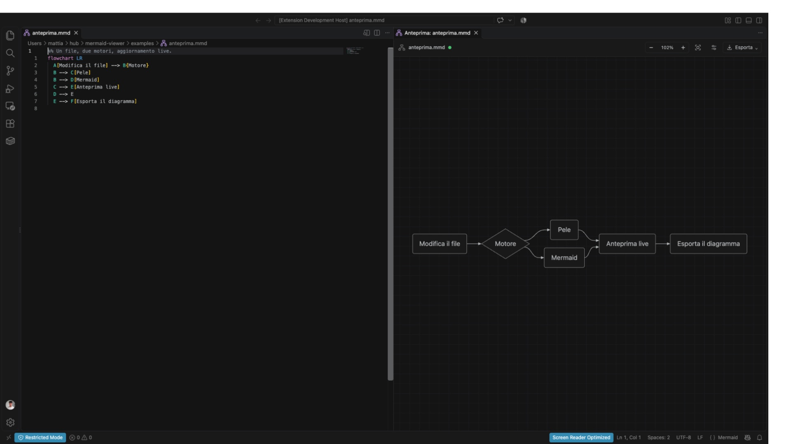
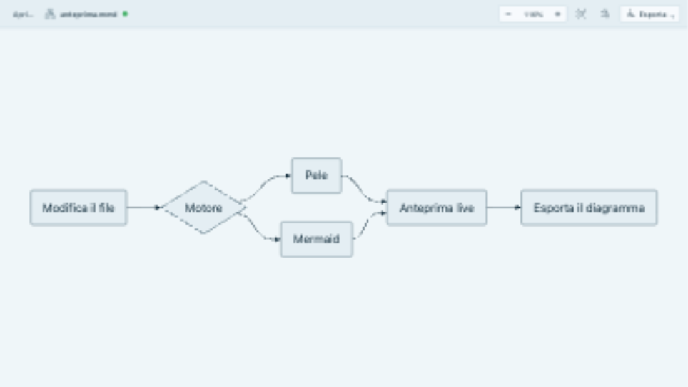
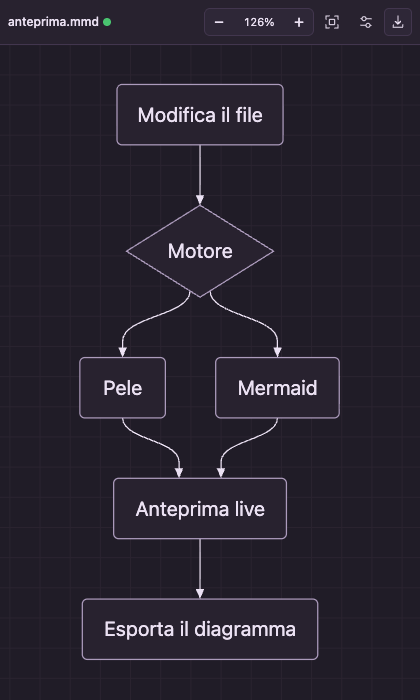
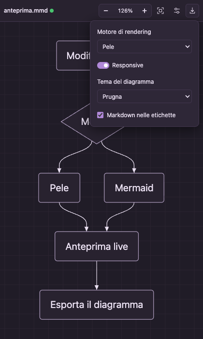

# Mermaid Viewer — Pele & Mermaid

Anteprima live dei file `.mmd` e `.mermaid`, nel browser e a lato dell’editor
VS Code. Interfaccia in italiano, pan/zoom, temi ed esportazione locale.


## Anteprima dell’interfaccia

VS Code: sorgente con syntax highlighting e icona Mermaid, anteprima affiancata
senza margini laterali. La barra compatta mantiene nome file, zoom, impostazioni ed esportazione sulla stessa riga.



App browser con tema **Oceano**:



Interfaccia della webview con tema **Prugna**, verificata in un pannello da 420 px:





Gli screenshot usano [il diagramma di esempio](examples/anteprima.mmd).

## Estensione VS Code

1. Installa il pacchetto `artifacts/mermaid-viewer.vsix` con **Extensions → … →
   Install from VSIX…**.
2. Apri un file `.mmd` o `.mermaid`.
3. Premi l’icona **Apri anteprima a lato** nella barra dell’editor, oppure esegui
   **Mermaid Viewer: Apri anteprima a lato** dalla palette comandi.
   È disponibile anche nel menu contestuale dell’Explorer.
4. Scorciatoia: `Cmd+K V` su macOS, `Ctrl+K V` su Windows/Linux.

I file `.mmd` e `.mermaid` hanno una grammatica TextMate con evidenziazione di
parole chiave, commenti, frecce, stringhe e colori, oltre a completamento delle
parentesi e commenti `%%`. L’icona Mermaid ha varianti per temi chiari e scuri;
un tema icone che associa esplicitamente questi file può sostituirla.

L’anteprima segue anche le modifiche non salvate, con debounce di 100 ms. Ogni
file ha il proprio pannello: richiamare il comando riutilizza quello esistente.
Non richiede Bun, un server o una connessione Internet.

Puoi scegliere **Pele / Mermaid** e **Responsive** dal menu **Opzioni anteprima**. Le opzioni della
singola anteprima sopravvivono quando il pannello viene nascosto; i valori
predefiniti per le nuove anteprime sono configurabili nelle impostazioni:

```json
{
  "mermaidViewer.engine": "pele",
  "mermaidViewer.responsive": true
}
```

Il tema automatico segue VS Code. La webview occupa tutta la larghezza del pannello,
senza il padding laterale predefinito. Il pulsante Apri, il selettore di file e il
trascinamento sono disabilitati nella webview: apri i documenti dall’editor o da Explorer.
Motore, Responsive, tema e Markdown sono nel menu **Opzioni anteprima**, accanto a **Esporta**. Sui pannelli stretti il nome del file si accorcia e il pulsante Esporta mostra solo l’icona; i comandi restano accessibili. SVG, PNG e PDF aprono la finestra di salvataggio nativa. Il PDF viene generato
localmente a richiesta, senza browser esterni o servizi online.

## App browser

Richiede [Bun](https://bun.sh). I renderer distribuiti sono inclusi nel repository:
non serve installare dipendenze o compilare per avviare l’app.

```bash
./mmv path/to/diagram.mmd
# oppure, senza file iniziale:
bun server.ts
```

Il server ascolta su `127.0.0.1:4321` e apre il browser. Usa **Apri…**, i recenti
o trascina un file. I file aperti dal selettore si aggiornano al salvataggio;
il trascinamento può fornire solo un’istantanea se il browser non supporta gli
handle del filesystem. Le modifiche mantengono zoom e posizione.

| Opzione | Default | Descrizione |
|---|---|---|
| `PORT` | `4321` | Porta iniziale; vengono provate fino a 12 porte |
| `NO_OPEN` | — | `1` evita l’apertura automatica del browser |

Se trova un’altra istanza del viewer sulla porta, il launcher apre il nuovo file
in una scheda di quell’istanza. Le radici consentite sono home, `/Volumes` e la
cartella di avvio; i percorsi reali sono verificati anche per i link simbolici.

## Renderer e dimensioni

[Pele](https://pele.run/) è il motore predefinito. Si caricano solo il nucleo e i
tipi di diagramma necessari. Mermaid viene caricato quando viene selezionato.
Entrambi lavorano localmente: il sorgente non viene inviato a servizi esterni.

| | Responsive attivo | Responsive disattivato |
|---|---|---|
| Pele | Adatta il layout allo spazio: può avvolgere etichette e cambiare direzione | Mantiene direzione e dimensioni naturali |
| Mermaid | Mantiene il layout Mermaid e adatta lo zoom al pannello | Dimensioni naturali, zoom iniziale al 100% |

Cambiare Responsive ricentra sempre il diagramma: attivandolo adatta l’inquadratura,
disattivandolo centra alle dimensioni naturali (100%). Il ridimensionamento adatta
il layout Pele con un debounce di 120 ms soltanto quando cambia la larghezza.
Cambiare solo l’altezza o ridimensionare in modalità fissa non ricrea l’SVG.
Dopo pan o zoom manuali viene conservato il punto al centro della vista. In modalità fissa
puoi comunque usare zoom e **Adatta** manualmente. Cambiare motore o modalità
ricalcola l’inquadratura; le modifiche al file conservano la vista corrente.

Pele interpreta sintassi Mermaid con un proprio layout: posizioni e percorsi
possono differire. Non supporta HTML arbitrario nelle etichette o plugin esterni;
i colori `themeVariables` Mermaid non si applicano a Pele. Puoi passare a Mermaid
per confrontare la resa. Non viene effettuato un cambio di motore silenzioso in
caso di errore. Vedi [compatibilità Pele](https://pele.run/compatibility) e
[note di ricerca](docs/pele.md).

Nove temi nel menu **Opzioni anteprima**: automatico, chiaro, scuro, neutro,
forest, **Oceano**, **Prugna**, **Sabbia** e **Grafite**. I quattro temi aggiuntivi
colorano sia l’interfaccia sia il diagramma con entrambi i motori. L’opzione **Markdown**
converte le etichette con grassetto/corsivo/codice nel formato delle markdown
string senza modificare il file originale. Le preferenze del browser sono salvate
in localStorage. I link e le immagini nei diagrammi sono disabilitati.

## Export e controlli

- **SVG**: vettoriale, con dimensioni, sfondo e variabili di tema Pele incorporate.
- **PNG 1× / 2× / 4×**: Pele usa direttamente l’SVG; Mermaid viene renderizzato
  con etichette SVG. Alcune etichette Mermaid multilinea non sono esportabili in
  PNG: in quel caso viene mostrato un messaggio. Il fattore viene ridotto oltre
  16.384 pixel per lato o 32 milioni di pixel complessivi.
- **PDF**: nell’estensione genera un PDF con immagine PNG a 2× su una pagina
  proporzionata al diagramma, con gli stessi limiti di risoluzione del PNG. Il
  testo è rasterizzato, non selezionabile; alcune etichette Mermaid multilinea
  richiedono il passaggio a Pele o l’export SVG. Nell’app browser resta disponibile
  la stampa vettoriale: scegli “Salva come PDF”.

| Controllo | Azione |
|---|---|
| Trascina / rotella | Pan |
| Cmd/Ctrl + rotella, pinch | Zoom sul puntatore |
| `+`, `−` | Zoom |
| `0`, pulsante percentuale | 100% |
| `F`, doppio clic, Adatta | Adatta alla finestra |
| Cmd/Ctrl + O | Apri file (solo browser) |

Un sorgente vuoto cancella l’anteprima. Un errore mantiene l’ultimo diagramma
valido e mostra il messaggio come testo. Il limite del sorgente è 50.000 caratteri.

## Sviluppo e verifica

```bash
bun install --frozen-lockfile
bun run test                # renderer, watcher, server e fixture Mermaid
bun run test:extension      # test nell’Extension Host di VS Code installato
bun run package:extension   # genera artifacts/mermaid-viewer.vsix
```

Per `test:extension`, su macOS viene usata `/Applications/Visual Studio Code.app`;
su altri sistemi imposta `VSCODE_EXECUTABLE` al binario VS Code. Il test usa un
profilo temporaneo e non installa l’estensione nel profilo personale.
Premi F5 nel repository per provarla manualmente nell’Extension Development Host.

`tests/browser.js` è un’espressione asincrona eseguibile nella console del viewer:
verifica renderer lazy, responsive/fisso, aggiornamenti e SVG/PNG/PDF in un iframe con
CSP e messaggi equivalenti alla webview. I test nell’Extension Host verificano
attivazione, pannello affiancato, modifiche non salvate, riuso e chiusura.

```bash
node test.mjs path/to/folder # regressione Mermaid su file personali
bun run vendor              # rigenera gli asset locali dalle versioni nel lockfile
```

Il frontend è JavaScript senza framework. `public/renderers.js` isola i motori e
serializza Mermaid, che ha una configurazione globale. Il viewer ignora i risultati
di render superati da una nuova modifica. `watch-file.ts` condivide un watcher
per percorso fra tutte le schede: osserva la directory per gestire i salvataggi
atomici e confronta i contenuti ogni 500 ms anche sui filesystem di rete.
L’estensione usa `extension/extension.cjs` e lo stesso frontend, con risorse locali,
CSP e trasporto a messaggi al posto di HTTP/SSE.

I renderer sono vendorizzati per consentire l’uso offline senza build; le rispettive
licenze sono in `public/vendor`. Il pacchetto VSIX include gli asset già pronti.

## Licenza

[MIT](LICENSE). Autore: [@mmattia09](https://github.com/mmattia09).
